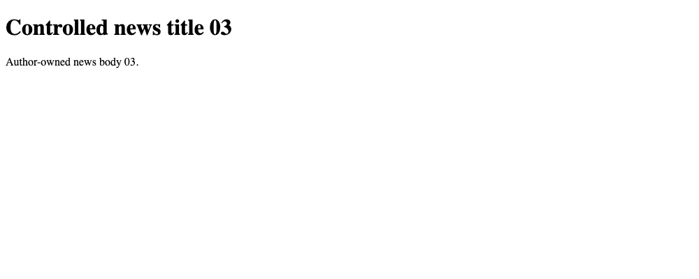
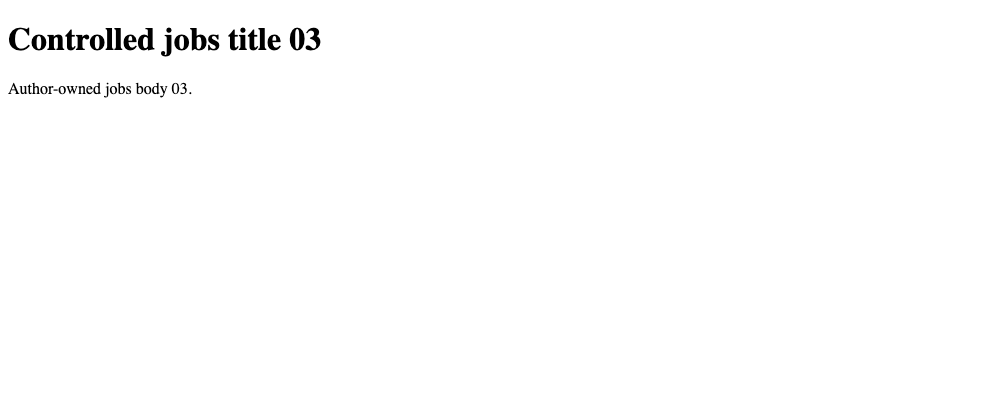
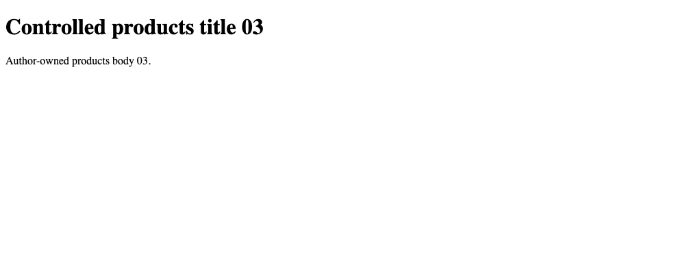

# Fixed HTML extraction fixtures

This collection contains 60 deterministic pages: 20 news pages, 20 employment
pages, and 20 product pages. Each group exercises five extraction conditions:
JSON-LD, metadata, CSS selectors, graph-shaped structured data, and malformed
JSON-LD with CSS fallback.

`manifest.jsonl` records the expected fields, extraction mapping, layout,
license, and SHA-256 checksum for every page. The manifest is the answer key
used by the extraction experiments.

Many JSON-LD and metadata fixtures appear blank in a browser because their
information is machine-readable rather than visible page text. The rendered
examples below come from this collection's visible CSS-layout fixtures and
illustrate the deliberately minimal presentation.

These are exact local renders of generated controlled fixtures, not captures of
real websites. The pages remain visually simple because the experiment tests
extraction behavior rather than visual design.
