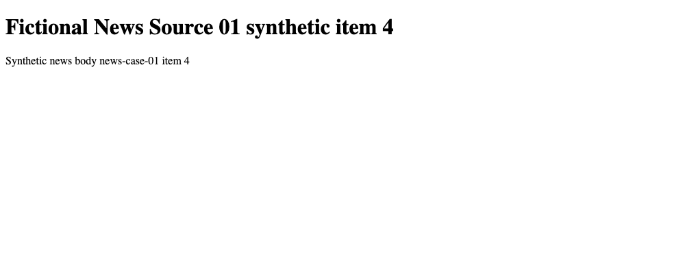
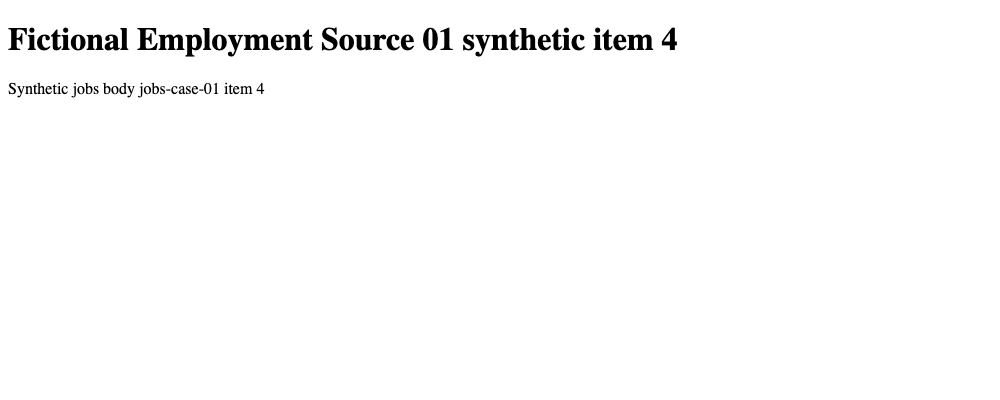
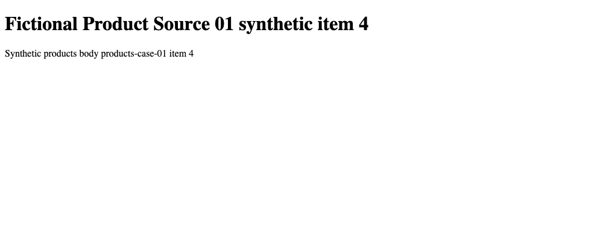

# Fictional site-pattern corpus

This collection contains 100 generated pages across 20 fictional website
configurations. The configurations cover news, employment, and product pages
with different URL prefixes, selectors, structured-data properties, and source
labels.

- `catalog.json` defines the 20 fictional site configurations.
- `manifest.jsonl` lists every page, expected record, layout, checksum, and
  provenance label.
- `pages/` contains five generated layouts for each configuration.

The collection is used to test whether a template intended for one URL scope is
kept separate from templates for other websites, whether fallback preserves
coverage, and how extraction behaves after controlled markup changes.

The images are exact browser renders of the `item-4.html` CSS fixtures for the
first news, employment, and product configurations. They are intentionally
unstyled and use reserved `.example` identities. They are not screenshots of
public websites.
